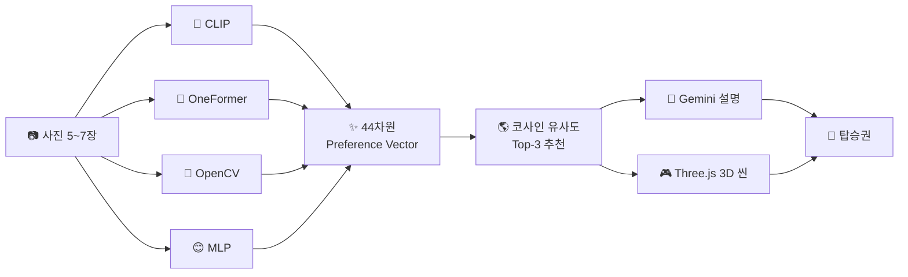
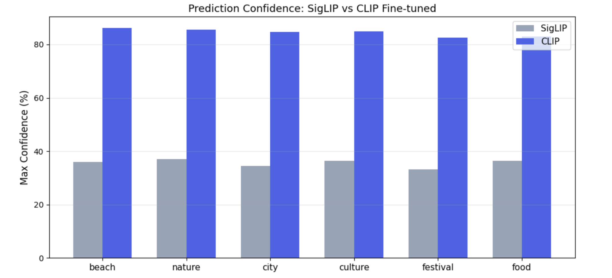
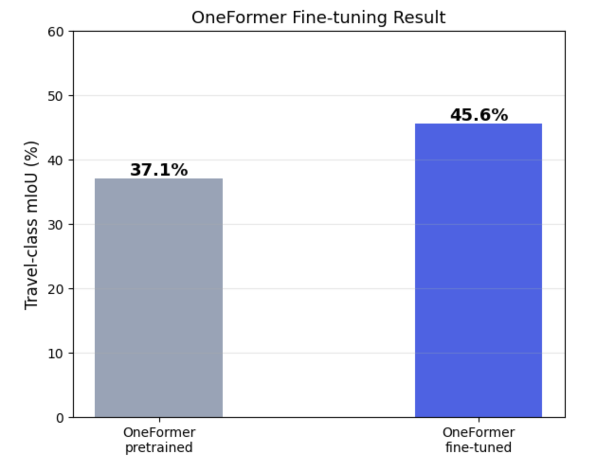
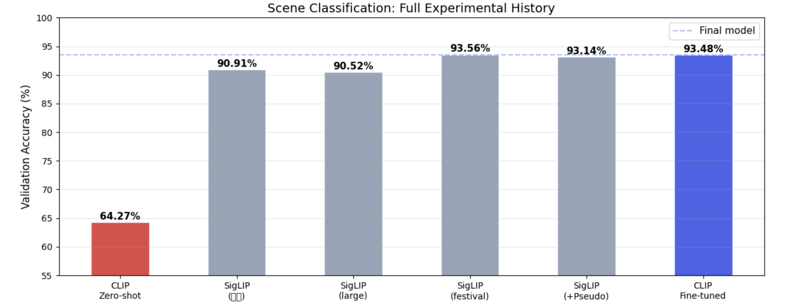
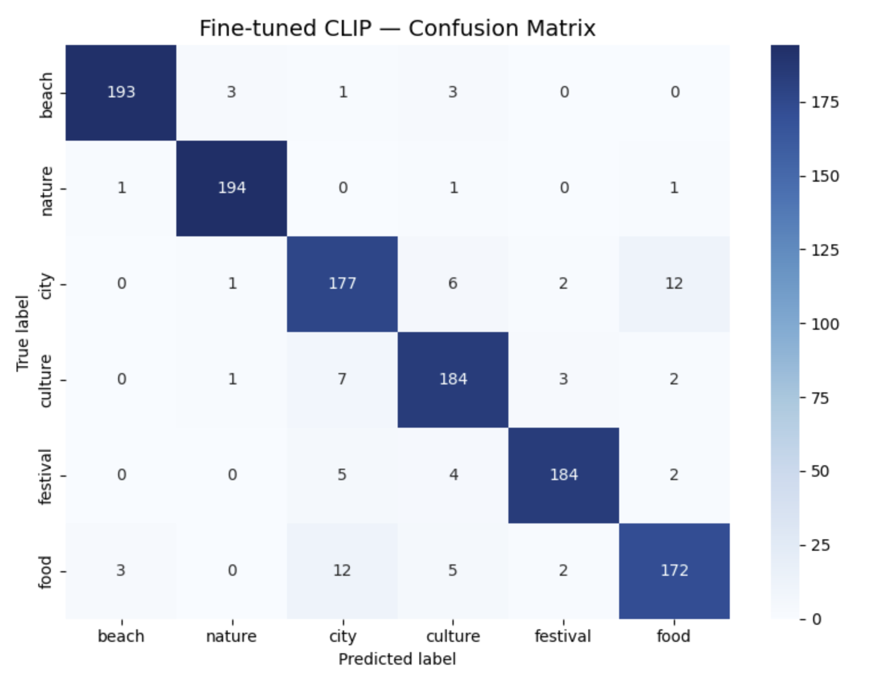
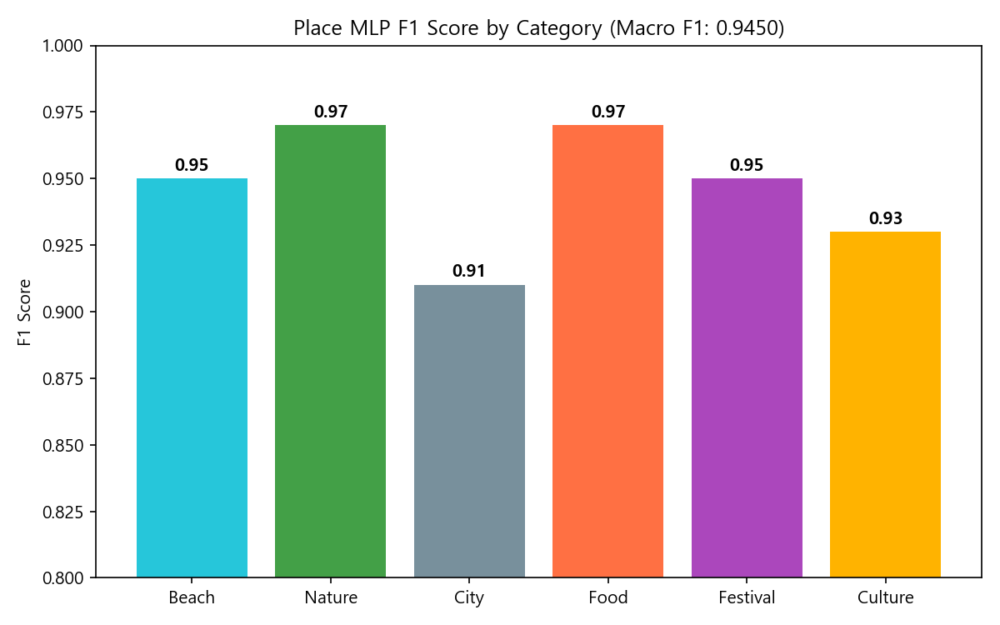
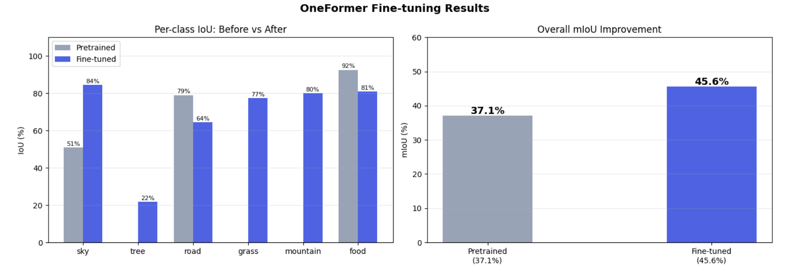

<div align="center">


### ✈️ 일상 사진 5~7장으로 나의 여행 취향을 알아보는 멀티모달 AI


<br/><br/>


<br/>

**👤 기획 · 데이터 · 모델 학습 · 백엔드 · 프론트엔드 1인 개발**

</div>

---

## 📌 한눈에 보기

| | |
|:--|:--|
| **문제** | 기존 여행 추천은 설문·예약 이력처럼 사용자가 **직접 남긴 데이터**에만 의존 |
| **아이디어** | 무의식적으로 찍은 **일상 사진** 속 장면·색감·분위기에서 취향을 추론 |
| **방법** | 4개 AI 모듈의 결과를 **44차원 Preference Vector**로 통합 → 여행지와 코사인 유사도 매칭 |
| **결과** | Top-3 여행지 추천 + Gemini 설명 + Three.js 3D 씬 + 탑승권 UI |

<div align="center">

| 🧠 CLIP 장면 분류 | 🌿 OneFormer 여행 클래스 | 😊 Preference MLP |
|:--:|:--:|:--:|
| **64.27% → 93.48%** | **mIoU 37.1 → 45.6** | **Macro F1 0.9450** |
| Zero-shot → Fine-tuning | 3개 데이터셋 통합 학습 | 멀티레이블 스타일 분류 |

</div>

---

## 🎥 Demo

<div align="center">

| 🏙️ City | 🏛️ Culture | 🌿 Nature |
|:--:|:--:|:--:|
| [▶ Video](https://github.com/user-attachments/assets/2e39bb36-876f-4b46-a000-fc9914e87034) | [▶ Video](https://github.com/user-attachments/assets/aa2ad316-7270-4293-bfdf-e43aabe4dada) | [▶ Video](https://github.com/user-attachments/assets/45d3d391-dde3-41f9-a6ee-d80ff77b4c9f) |
| 🍕 **Food** | 🌊 **Beach** | 🎆 **Festival** |
| [▶ Video](https://github.com/user-attachments/assets/5ef5fe29-4734-4f77-87b2-511de3855b48) | [▶ Video](https://github.com/user-attachments/assets/a79cddb6-0e5d-4cad-ab43-86cdc3fb5185) | [▶ Video](https://github.com/user-attachments/assets/96f4ace8-f7e2-4662-9a4c-6044df3dc3ec) |

</div>

---

## 🧠 왜 모델 하나로는 부족한가

여행 취향은 장면 하나로 정해지지 않고 **장면 + 공간 구성 + 색감 + 분위기**의 조합입니다.

| 모듈 | 담당 | 혼자서는 못 하는 것 |
|:--:|:--|:--|
| **CLIP** | 장면 카테고리 | 색감·분위기·구성 |
| **OneFormer** | 공간 구성 (물·숲·건물·하늘·음식 비율) | 선호 추론 |
| **OpenCV** | 밝기·채도·대비·색온도 등 시각 통계 | 장면 의미 |
| **Preference MLP** | 스타일·분위기 | 공간 구조 |



### ✨ 44차원 Preference Vector

| Scene | Visual | Semantic | Style | Place | Mood | Interest | **합계** |
|:--:|:--:|:--:|:--:|:--:|:--:|:--:|:--:|
| 6 | 6 | 5 | 6 | 6 | 6 | 9 | **44** |

> 예시: `beach 0.82 · warm_tone 0.79 · saturation 0.74 · energetic 0.68`
> → 🥇 발리 🥈 푸켓 🥉 세부
> → 🤖 *"따뜻한 색감과 활기찬 환경을 선호하며, 해변과 현지 음식이 어우러지는 여행지가 잘 맞을 것 같습니다."*

---

## 💡 핵심 의사결정

### 1️⃣ 정확도가 아니라 신뢰도로 모델을 골랐습니다

| 모델 | 정확도 | 예측 신뢰도 |
|:--:|:--:|:--:|
| SigLIP | 93.56% | 33~37% |
| **CLIP (Fine-tuned) ✅** | 93.48% | **79~87%** |

정확도는 SigLIP이 0.08%p 높았지만, 신뢰도 값이 Preference Vector에 그대로 들어가기 때문에 **벡터 품질이 안정적인 CLIP**을 선택했습니다.

<p align="center"></p>

### 2️⃣ 분할 모델 3개 대신, 하나의 OneFormer로 통합 학습

ADE20K(범용 장면) · FoodSeg103(음식) · Cityscapes(도시)의 라벨을 **하나의 체계로 매핑**해 단일 모델로 학습했습니다.
→ 여행 클래스 **mIoU 37.1 → 45.6 (+8.5)**

<p align="center"></p>

### 3️⃣ 라벨이 없는 스타일 데이터는 Pseudo Labeling으로

학습 전 라벨 분포를 확인해 `cozy` 쏠림을 발견하고, 원인이던 규칙을 수정했습니다. 남은 불균형은 **클래스 가중치 + 희소 클래스 샘플러 + BCE Loss**로 보완해 **Macro F1 0.9450**을 기록했습니다.

### 4️⃣ LLM은 설명만, 판단은 비전 모델이

Gemini는 추천 이유를 **사람이 읽을 수 있게 설명하는 역할**로만 쓰고, 취향 판단은 비전 모델의 결과로만 수행하도록 역할을 분리했습니다.

---

## 📊 학습 결과

<p align="center"></p>
<p align="center">
  
  
</p>
<p align="center"></p>

---

## 🛠️ Tech Stack

| AI | Backend | Frontend | Infra |
|:--:|:--:|:--:|:--:|
| CLIP · OneFormer · OpenCV · MLP | FastAPI · PyTorch · Transformers | Three.js · HTML/CSS/JS | Gemini API · Colab · Kaggle GPU |

---

## ⚠️ 한계와 개선 방향

| 한계 | 개선 방향 |
|:--|:--|
| 여행 카테고리가 6개로 거침 | Beach → 리조트·액티비티 등 세분화 |
| 여행 도메인 통합 벤치마크 부재 | 데이터셋별 평가 → 추천 품질 평가 체계 마련 |
| Pseudo Label 노이즈 | 사람이 라벨링한 데이터와 혼합 |
| 수작업 설계 벡터 | 학습 가능한 선호 임베딩 |
| 스타일 라벨의 주관성 | 사용자 피드백 루프로 개인화 |
| 외부 LLM API 의존 | 경량 로컬 모델로 대체 |

---

<details>
<summary><b>🚀 실행 방법</b></summary>

```bash
git clone https://github.com/ysnni2/PhotoTrip.git
cd PhotoTrip
python -m venv venv && source venv/bin/activate   # Windows: venv\Scripts\activate
pip install -r requirements.txt
echo "GOOGLE_API_KEY=your_gemini_api_key" > .env
python -m uvicorn backend.main:app --reload --port 8000
```

`models/` 폴더에 학습된 가중치(`best_clip.pth`, `mlp_*_best.pth`, `oneformer_top/`)를 넣은 뒤 `http://localhost:8000`으로 접속합니다.

</details>

<details>
<summary><b>📖 References</b></summary>

- Radford et al. (2021). CLIP
- Zhai et al. (2023). SigLIP
- Jain et al. (2023). OneFormer
- Cheng et al. (2022). Mask2Former
- Datasets: ADE20K, FoodSeg103, Cityscapes

</details>

<div align="center">


</div>
